# Atelier

Vintage watch faces, working complications. One clockface app for the UNA watch with eight analogue faces. Each face's complication shows your own data.

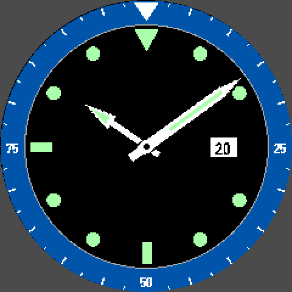

## The faces

| | Face | The complication shows |
|---|---|---|
| 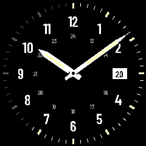 | **Field** | Minute track lights up with your steps; turns yellow at your goal |
| 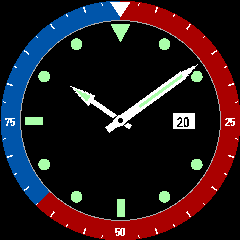 | **Diver** | Red-and-blue bezel fills with your steps; pip turns yellow at your goal |
| 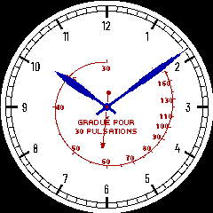 | **Doctor** | Swiss snail pulsometer points at your resting heart rate |
| 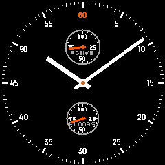 | **Track** | Coach's stopwatch registers: active minutes and floors |
| 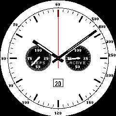 | **Panda** | Chronograph registers: steps and active minutes |
| 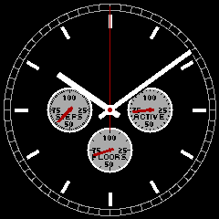 | **Tricompax** | Three registers: steps, floors and active minutes |
| 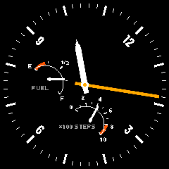 | **Driver** | Dial turned 45° for the wheel; fuel gauge = battery, rev counter = steps in the last hour |
| 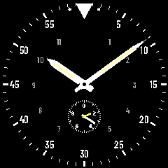 | **Pilot** | Altimeter: altitude and today's climb |

Registers read as a share of your own daily goals (from the watch settings). A register whose goal is passed gets a yellow rim:

| | | |
|---|---|---|
| 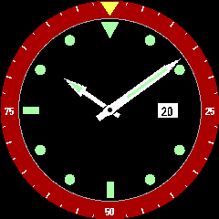 | 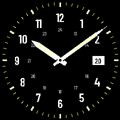 | 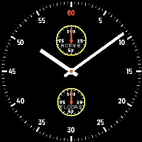 |

## How it works

- **A different watch each day.** The face changes at local midnight, like picking a different watch from your watch box.
- **Made for this screen.** Every face is drawn for the 240 × 240, 64-colour display: hard edges, a pixel font for small text, odd-width hands that turn about one centre pixel.
- **Eight faces in one small app.** The dials are stored as compressed colour runs (about 45 KB for all eight) and painted straight from that data, so nothing large sits in memory.
- **Power.** The face updates once a minute and only listens to the sensors the current face shows.

Sensors: step counter, activity minutes and floors, daily heart-rate metrics (resting HR), battery level, altimeter.

Built with LVGL and tested in the simulator on a Mac. The screenshots above are frames from the simulator.
